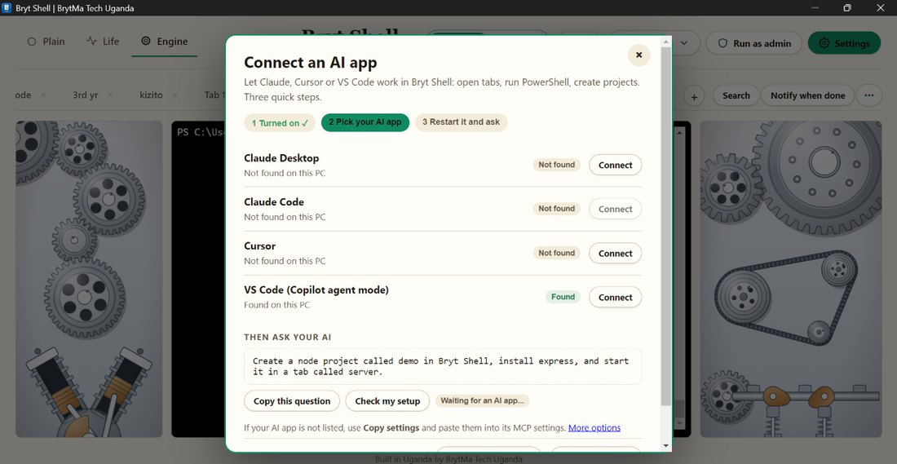
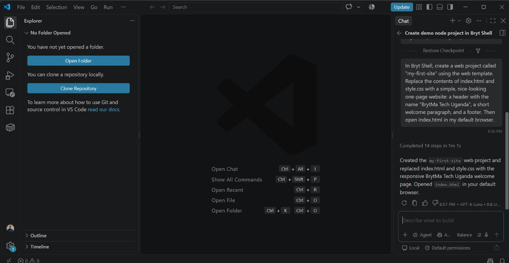
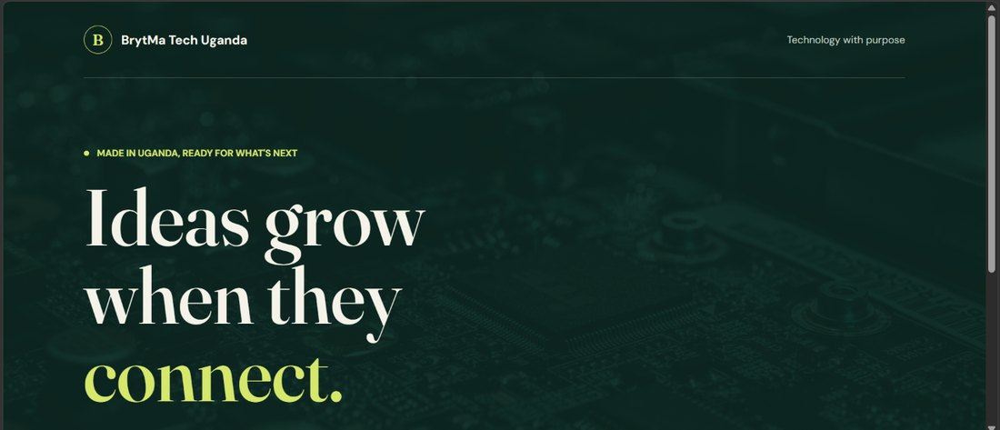
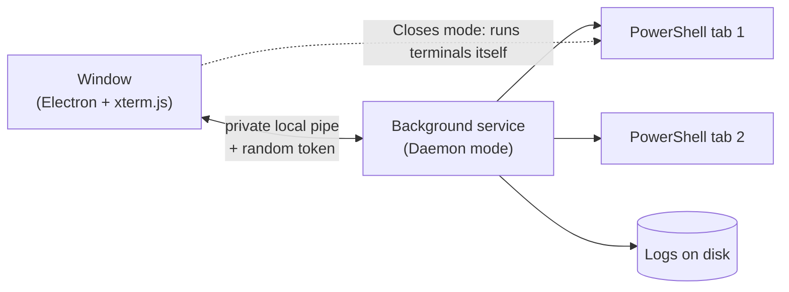

<p align="center">
  
</p>

<h1 align="center">Bryt Shell</h1>
<p align="center"><b>The PowerShell that never forgets.</b><br>
Tabbed, named, persistent terminals for Windows, with live status lights, a test tube that shows what failed, and a running engine that fills the window.<br>
<sub>Built in Uganda by BrytMa Tech Uganda</sub></p>

<p align="center">
  <a href="https://github.com/muhumuza684/bryt-shell/releases/latest/download/Bryt-Shell-Setup.exe">
    
  </a>
</p>
<p align="center"><sub>Windows 10 and 11 · free · one file to double-click · <a href="#about-the-windows-warning">about the Windows notice</a></sub></p>

<p align="center">
  <a href="https://github.com/muhumuza684/bryt-shell/releases/latest">All releases</a> ·
  <a href="https://muhumuza684.github.io/bryt-shell/">Landing page and live demo</a> ·
  <a href="#faq">FAQ</a> ·
  <a href="#support">Support</a>
</p>

<p align="center">
  
  
  
</p>

<p align="center">
  
</p>
<p align="center"><sub>The engine runs while a command runs. Left and right of the terminal: gear train, V-twin with pistons and rods, flywheel, belt drive, camshaft and valves.</sub></p>

## Let an AI work in it, in tabs you can watch

<p align="center"></p>

1. Press **Yes, connect** when Bryt Shell offers (or click the **AI** chip and press **Connect my AI apps**). One click connects Claude Desktop, Claude Code, Cursor or VS Code.
2. Ask it in plain words:

<p align="center"></p>

3. A tab marked **AI** opens, the files appear, and the page opens in your browser:

<p align="center"></p>

You see everything it does, risky actions ask you first, and the red **Stop AI** button stops it at once. [Details](#ai-access-mcp) · [Send a project to another PC](#send-a-project-to-another-pc)

---

## Why Bryt Shell?

If you run many programs at once (Docker, Airflow, API servers, build watchers), a normal PowerShell window has three problems: close it and the history is gone, restart the PC and everything is gone, and with ten windows open you cannot tell which one failed.

Bryt Shell fixes those:

- **Your work survives.** Every tab keeps its full history on disk. Restart the PC and your tabs, names and logs come back.
- **Real names.** Call a tab "airflow" or "api-server" instead of "Tab 3".
- **You can see what happened.** Optional **Lab** shows traffic lights for all tabs and a glass test tube for the active one.
- **You decide what happens on close.** Stop everything, or keep programs running in the background.
- **Calm and premium.** The main window is just tabs and a terminal. Everything else lives in **Settings**.

## Features

| | |
|---|---|
| **Real terminal** | Full PowerShell through Windows ConPTY: colors, tab completion, Ctrl+C, vim, ssh, resizing. Uses PowerShell 7 if installed, otherwise Windows PowerShell. |
| **Tabs** | **+** asks for a name, **×** deletes (with confirmation), double-click renames. In Lab mode a colored dot on each tab shows its state. |
| **Persistent logs** | Output is saved per tab and replayed when you reopen. Scrollback is 10,000 lines. Logs over 2 MB are trimmed to the most recent 1 MB when the app starts. |
| **Two modes** | *Closes with window* or *Daemon* (see below). |
| **Startup command** | Give a tab a command (for example `docker compose up`) and it runs whenever that tab's shell starts, including after a restart. |
| **Start at login** | In the installed app and Daemon mode, Windows starts Bryt Shell silently at login and starts tabs that have a startup command. |
| **Log tools** | **Search** (Ctrl+F), **Export log** (clean `.txt` or raw `.log`), **Notify when done**. |
| **Run as admin** | Opens an elevated copy with its **own separate tabs and logs**. |
| **Settings** | General, Appearance, Lab, Engine, Faith, Support, About and a 20-question FAQ, all in one place. |

## The main window

A calm, balanced header in a light "Ivory" design (and a warm black one):

- **Left:** the **Mode** button (choose **Plain**, **Lab** or **Engine** from a small menu), then **Web** and **Access**, which control what AI apps may do (see below).
- **Center:** the Bryt Shell name.
- **Right:** the **White / Black** theme switch (White means your last light theme), the **Mode** chip, **Run as admin** and **Settings**. The Mode chip opens a small menu with **Change mode** and, in Daemon mode, **Quit & stop all**.

Under the header, the tabs sit on one line with a soft fade instead of a scrollbar, the **+** is always visible, and the tools are beside them: **Search**, **Notify when done** and a **⋯** menu with **Export log**, **Clear log** and **Startup command**. Everything optional, including all of Faith, is in **Settings**.

## Settings

Open **Settings** from the header. Press Esc to close it.

| Page | What it does |
|---|---|
| **General** | What happens when you close the window (Mode), Start at login, and resetting the close prompt. |
| **Appearance** | Three themes (**Ivory**, **White**, **Black**) and, folded away under **Colors**, an accent color picker and a terminal color picker. |
| **Lab** | Turn Lab on or off, see what each face means, and edit level recipes. |
| **Engine** | Turn the running engine on or off, with **Preview** buttons (Run, Crash). |
| **Faith** | Optional Christian or Islamic styling and verses, including your own. Hidden until you switch it on (see below). |
| **Support** | Write to support, copy the address, copy your system details. |
| **About** | What Bryt Shell can do, and live system details. |
| **FAQ** | Twenty questions and answers. |

<p align="center">
  
</p>

## Appearance and colors

Settings, Appearance.

- **Three themes:** **Ivory** (warm and light, the default), **White** (clean and bright) and **Black** (warm black). The header switch flips between your light theme and Black.
- **Colors** (folded away until you open it): pick an **accent color** from seven presets or any custom color, and a **terminal color** from five presets or any custom color. The text on buttons and the terminal text color adjust automatically so everything stays readable. **Reset colors** puts the defaults back. Faith styles keep their own colors while Faith is on.
- **Clear buttons:** every control is a filled, bordered button, with a bright accent-colored **Settings** button. All text and background pairs in the three themes meet WCAG AA contrast (4.5:1 or better).

<p align="center">
  
</p>

## The two modes

Click **Mode** (or Settings, General). Switching stops the programs running right now and restarts the app. Saved logs are always kept.

| | **Closes with window** | **Daemon (keeps running)** |
|---|---|---|
| Close the window | Everything stops | Asks: **Keep running / Stop everything / Cancel** |
| CPU while the window is closed | None | Only the programs you left running |
| Reopen | Logs come back, programs must be started again | Reattaches to the still-running programs, with everything they printed meanwhile |
| Stop it all | Close the window | **Quit & stop all** button |

In Daemon mode a small background service owns your terminals. It is idle and light, and it **quits by itself after 5 minutes** if no window is open and nothing is running. A background service that survived an app update still runs the old code, so Bryt Shell shows a banner asking you to click **Quit & stop all** once and reopen.

> No application can keep programs alive through a Windows restart. After a restart you get your tabs, names and full logs back, and tabs with a startup command start again by themselves.

## One experience at a time

Bryt Shell offers four experiences and runs **one at a time**, so the window never feels crowded:

| Experience | Where you choose it | What it does |
|---|---|---|
| **Plain** | Header | Just tabs and the terminal. |
| **Lab** | Header, or Settings, Lab | Status lights, test tube, faces. |
| **Engine** | Header, or Settings, Engine | A running engine fills the left and right of the window. |
| **Faith** | Settings, Faith | Styled frames and a strip of verses. When Faith is on, the first header segment reads **Faith**. |

Choosing one turns the others off. Click the active one again to return to Plain.

## Lab

Choose **Lab** in the top bar (or Settings, Lab).

- **Signal (left):** a traffic light for *all* tabs. **Red** if any tab failed, **orange** if any is running, **green** if all finished fine (red beats orange beats green), plus a *Recent* list with durations.
- **Engine test tube (right):** a glass tube for the *active* tab. The liquid rises as the command runs, turns **green** on success, and turns **red** with an error pin where it failed. **Find the error** jumps to the error in the log.
- **Faces:** a smile when idle, a thinking face while running, a happy face on success, a crying face on failure, and a neutral face when *you* pressed Ctrl+C. Stopping a program yourself is never shown as an error.
- **Levels:** for commands it recognizes, the tube fills level by level (Docker compose up, git clone and pip install are built in). Unknown commands show a steady tube and turn green or red when they finish. Bryt Shell never fakes progress.

### Teach the tube your own commands

Settings, Lab, **Edit level recipes** opens `recipes.json`. Each recipe has a regular expression for the command (`match`) and a list of levels, each with a regular expression (`on`) that is looked for in the output:

```json
[
  {
    "name": "Docker compose up",
    "match": "^\\s*docker[ -]compose\\b.*\\bup\\b|^\\s*docker\\s+compose\\b.*\\bup\\b",
    "levels": [
      { "name": "Pull",    "on": "Pull(ing|ed)" },
      { "name": "Create",  "on": "Created" },
      { "name": "Start",   "on": "Started" },
      { "name": "Healthy", "on": "Healthy" }
    ]
  }
]
```

A level counts as reached the first time its pattern appears; levels only move forward. Changes apply to the next command you run.

## The engine

Choose **Engine** in the top bar (or Settings, Engine). A running engine fills the left and right of the window, and it is built with real mechanics:

- **Left:** a five-gear train whose teeth mesh exactly, above a V-twin with finned cylinders, bronze pistons, steel connecting rods and a counterweighted crankshaft. Piston motion follows the true crank-slider equation.
- **Right:** a flywheel with its bolt circle and ring gear, a starter pinion, a ribbed belt drive around three pulleys, and a camshaft whose lobes lift sprung valves.
- **It follows your command.** It spins up while a command runs and winds down when it ends. If the command **fails, the engine jams**: it shakes, sparks fly, a red glow appears and everything stops dead.
- **Light on your PC.** It only animates while a command is running, at 30 frames a second, and pauses when the window is hidden. Turn it off in Settings and it costs nothing.

## Faith styles and verses

Settings, Faith. Optional, and kept out of the way: nothing appears until you switch **Use Faith** on, and then its options unfold.

1. **Tradition:** Christianity or Islam.
2. **Style:** one of three, each recoloring the whole app and giving the frames a double gold line with ornamented corners.
3. **Show verses:** a strip of verses scrolls above the terminal and changes with what your command is doing: courage while it runs, thanksgiving after success, comfort after a failure.
4. **My verses:** paste the verses you love, one per line, with an optional reference after a dash (`Be still, and know that I am God. — Psalm 46:10`). Choose **Add to built-in** or **Only mine**. Your verses are saved separately for each tradition, work in Arabic too, and are never sent anywhere.

| | Styles |
|---|---|
| **Christianity** (King James Bible verses, public domain) | **Classic** (royal blue and white), **Stained glass** (jewel-tone frames), **Parchment & gold** (warm paper and gold) |
| **Islam** (short Arabic verses; hover for the English meaning) | **Emerald & gold** (with a star pattern), **Midnight & gold** (arabesque corners), **Sand & teal** (warm geometric frames) |

All six styles work in both the white and the black theme. The built-in verses are short extracts shown as reminders; if you spot a mistake in any of them, please [tell us](#support) and it will be corrected.

<p align="center">
  
</p>

## Install

### Option A: the installer (recommended)

1. Download [`Bryt-Shell-Setup.exe`](https://github.com/muhumuza684/bryt-shell/releases/latest/download/Bryt-Shell-Setup.exe) (one click, always the newest version).
2. Run it. Windows may show **"Windows protected your PC"** because the installer is not code-signed. Click **More info**, then **Run anyway**.
3. Open **Bryt Shell** from the desktop shortcut or Start menu.

The installer creates a desktop shortcut, a Start menu entry and an uninstaller (Settings, Apps).

### Replace an old installed copy

The desktop shortcut runs the **installed** copy, which only changes when you reinstall. From the project folder, run:

```powershell
.\reinstall-desktop.ps1
```

(or double-click `reinstall-desktop.bat`). It stops Bryt Shell, uninstalls the old desktop app and its shortcuts, builds a new installer and opens it. Your tabs, logs and settings are kept. Add `-DryRun` to see what it would do without changing anything. If a shortcut still opens an old version, run `.\reinstall-desktop.ps1 -ShortcutOnly` to repair the desktop and Start menu shortcuts. The installer also recreates the desktop shortcut on every update.

### Build from source

Requirements: **Windows**, **Node.js 20.19.5 or newer**, and internet for the first install. No compiler or Visual Studio is needed.

```powershell
git clone https://github.com/muhumuza684/bryt-shell.git
cd bryt-shell
npm install
npm start
```

Double-clicking `setup.bat` then `start.bat` does the same. To build the installer yourself:

```powershell
npm run dist
```

The result is `dist\Bryt-Shell-Setup.exe`. The build writes the icon and version info into the `.exe` with a small pure-JavaScript step (`build/afterPack.js`), so it works without Developer Mode or administrator rights.

## Share Bryt Shell

- **One-click download (always the newest version):** https://github.com/muhumuza684/bryt-shell/releases/latest/download/Bryt-Shell-Setup.exe
- **Releases page:** https://github.com/muhumuza684/bryt-shell/releases/latest
- **From inside the app:** Settings, About, **Download the newest version** opens that same download in your browser. The app never contacts the internet by itself.
- **Website:** https://muhumuza684.github.io/bryt-shell/
- The installer is built by GitHub from this public source code and attached to each [release](https://github.com/muhumuza684/bryt-shell/releases).

**Check your download.** Each release includes a `.sha256` file. In PowerShell:

```powershell
Get-FileHash .\Bryt-Shell-Setup.exe -Algorithm SHA256
```

The result must match the text in the `.sha256` file.

### First-time GitHub setup (maintainers)

If this folder is not a git repository yet, run `.\setup-github.ps1` once. It checks git, connects the folder to `https://github.com/muhumuza684/bryt-shell`, commits your files and pushes them. It never overwrites work that is already on GitHub unless you add `-Force`, and `-DryRun` shows what it would do.

### Keeping GitHub tidy (maintainers)

`.\cleanup-github.ps1` removes old releases (and their tags) and old build runs, which also frees the 70 MB build files they hold. It always keeps the newest release and the newest build. It needs the GitHub CLI (`winget install GitHub.cli`, then `gh auth login`). Run `-DryRun` first to see the list; it asks you to type DELETE before deleting anything.

### Publishing a new version (maintainers)

1. Raise the version in `package.json` and commit.
2. Run `.\release.ps1` (add `-DryRun` to preview). It creates the version tag and pushes it.
3. GitHub builds the installer (about 3 to 6 minutes) and publishes it with its checksum. Watch it in the **Actions** tab.

## About the Windows warning

The installer is **not code-signed yet**, so Windows SmartScreen may show "Windows protected your PC" the first time you run it. This notice appears for new or rarely downloaded apps. Click **More info**, then **Run anyway**. Code signing is planned; even a signed app can show the notice at first, because Windows builds trust from real downloads over time.

## Only one Bryt Shell at a time

Click the shortcut once or ten times: only **one** Bryt Shell opens, and the extra clicks just bring the open window to the front. This matters because every window shares one background service, and closing one window with "Stop everything" used to cut the service off for the others ("Lost connection").

- The copy that starts at Windows login (no window) and the **Run as admin** copy are separate and never get in each other's way.
- If an earlier window is frozen and no longer answers, the next launch replaces it.
- If an old background service is stuck (alive but silent) after a restart or crash, Bryt Shell now stops it and starts a fresh one, instead of waiting for it and needing a reboot.

## Startup speed

- **The window and your tabs appear at once.** The terminal fills in as soon as the background service is ready; the app never waits for the service before showing itself.
- **The very first launch after installing is the slowest,** because Windows scans a new, unsigned program. Later launches are quick.
- **In Daemon mode the service keeps running when you close the window,** so reopening Bryt Shell reconnects instantly. Turn on **Settings, General, Start at login** and the service is already running when you sign in.
- **If the background service ever stops, Bryt Shell heals itself.** It reconnects, or starts a fresh service, and re-attaches your terminals within a second or two, so you can keep working and creating tabs. If a service cannot be brought back, the window carries on with its own terminals and offers **Try again**. What happened is written to `%APPDATA%\Bryt Shell\daemon.log`.
- The installer is a one-click installer: double-click it, wait a few seconds, and Bryt Shell opens. It installs for your account only, so it needs no administrator permission.

## Your data and privacy

- Everything is stored under `%APPDATA%\Bryt Shell` (`user\` for normal tabs, `admin\` for the elevated workspace), plus `recipes.json` and `settings.json`. Appearance choices are kept inside the app.
- Bryt Shell makes **no network connections of its own** and has no accounts or telemetry. (AI access, if you switch it on, is a local pipe only; see AI access.) The only things it opens outside the app are the links you click (support email, project pages).
- In Daemon mode the window and the background service talk over a private local Windows pipe, and the service only accepts a connection that presents a random token stored in your profile folder.
- Deleting a tab deletes its saved log.

## AI access (MCP)

Bryt Shell can let AI apps you trust (Claude Desktop, Claude Code, Cursor, VS Code and any other app that speaks the [Model Context Protocol](https://modelcontextprotocol.io)) use it as their hands: open tabs, run PowerShell, create projects, read and write files. It is **off by default**.

**Turn it on, in one click.** A few seconds after start-up, if Claude Desktop, Cursor or VS Code is on your PC, Bryt Shell asks: *"I found VS Code on this PC. Let it use Bryt Shell?"* Press **Yes, connect**. (Or click the **AI** chip in the header and press **Connect my AI apps**.) That one click explains what AI access means, turns it on, finds Claude Desktop, Claude Code, Cursor and VS Code, and connects them. Nobody has to see or paste any settings. Restart the AI app, then ask it in plain words: *"Create a node project called demo in Bryt Shell, install express, and start it in a tab called server."*

Behind the scenes Bryt Shell adds itself to each app's standard MCP settings without touching your other servers (a backup is kept), and it quietly fixes its own entry after an update or a move. If something does not work, the **AI** window has a **Check my setup** test, and an option for apps that are not listed. Those settings are configuration text, not something to paste into a chat.

Web chat apps (claude.ai or chatgpt.com in a browser) cannot reach a program on your PC, by design. Use the desktop app of that AI instead.

| Tool | What it does |
|---|---|
| `list_tabs`, `create_tab`, `rename_tab`, `close_tab` | Manage tabs. Tabs made by an AI carry an **AI** badge |
| `run_in_tab` | Run a command in a persistent tab and get its output and exit code. `background: true` (with an optional `readyText`) is for servers and watchers: it returns as soon as the program is up and leaves it running |
| `read_tab_output`, `send_to_tab` | Follow a long-running program, answer a prompt, press Ctrl+C |
| `run_command` | Run a one-shot command in a hidden PowerShell and get stdout, stderr and exit code |
| `create_project` | Make a project from a template (`empty`, `node`, `python`, `web`, `powershell`), run `git init` and open a tab in it. Default folder: `%USERPROFILE%\BrytProjects` |
| `list_directory`, `read_file`, `write_file` | Work with files directly |
| `web_fetch`, `open_url` | Read a web page as text (no cookies, local addresses blocked unless you allow them); open a page in Chrome, Edge, Firefox or your default browser |
| `delete_path`, `recycle_bin` | Delete to the Recycle Bin (recoverable) or permanently (always asks); list, restore or empty the Recycle Bin |
| `apps` | List apps with open windows, open an app, close one (always asks; system processes and Bryt Shell itself are refused) |
| `export_project`, `import_project` | Pack a project into one `.brytproject` file / import one (you always get to look first) |

**You stay in control.**
- Nothing listens until you switch it on, and then only on a local Windows pipe. Every request needs a secret token that lives in a file in your profile folder (it is never written into the AI app's config).
- **Questions show up as a banner inside the window** (or a Windows dialog if Bryt Shell is minimised). **Deny** has the focus, so a stray Enter never approves. No answer in two minutes counts as no.
- **Risky actions always ask**, in both policies: recursive or forced deletes, registry edits, disk and boot changes, shutdown, downloading code and running it, administrator prompts, user and service changes, firewall and Defender changes, `git push --force` and `git reset --hard`, and anything that touches passwords, keys or browser data (`.ssh`, cloud credentials, cookies and so on). There is no "trust" shortcut for these. You can also choose **Ask before every action**. This list is a speed bump that makes you look; it is **not a sandbox**, so only connect AI apps you trust.
- **Trusted folders.** Your projects folder is trusted by default: AI works there without asking about files. Anywhere else it asks, and the banner offers **Allow and trust this folder** so you decide once. Manage the list in Settings, AI access.
- **Stop AI** (the red chip in the header) presses Ctrl+C in every tab an AI is running things in, cancels any waiting question, and switches AI access off.
- AI never gets the administrator copy of Bryt Shell unless you allow it separately. System folders are refused.
- Every action is written to `%APPDATA%\Bryt Shell\ai-audit.log`, and Settings, AI access shows the recent ones in plain words (Allowed, Denied or Error).
- Remember that an AI can be misled by text it reads (a web page, a README, program output). That is why dangerous actions ask you even in automatic mode.

Check the plumbing without Windows or an AI: `npm run test:ai`.

## Access and Web: what AI apps may do

Two buttons on the left of the header decide how much an AI may touch. Every switch is **Off**, **On** or **Admin only**.

| Button | Switch | What it covers |
|---|---|---|
| **Access** | Files | Read, write and delete files and folders (deleting goes to the Recycle Bin) |
| | Recycle Bin | Look inside, restore, empty |
| | Apps | See open apps, open them, close them |
| | Install software | `winget`, `choco`, `scoop`, installers |
| | Windows settings | Registry, firewall, services, power, time zone and similar |
| **Web** | Read web pages | `web_fetch` |
| | Open pages in the browser | `open_url` |
| | Internet for commands | Downloads, `git`, `npm`, `pip`, `winget` and similar |
| | Allow local addresses | Let `web_fetch` read `localhost` and your home network (off by default) |

**Admin only** means the switch works only in the administrator copy of Bryt Shell (the **Run as admin** button), and only if you also allowed AI there. That is how you give an AI "full control" of the PC while keeping the dangerous parts behind a second, deliberate step. Presets in the Access window fill every switch at once: **Careful** (the default), **Builder**, **Full control** and **Lock down**.

When something is switched off the AI gets a clear message ("BLOCKED by the Access settings...") that tells it not to work around the block and to ask you, and the attempt shows as **Blocked** in the activity list.

Be clear about what this is: the switches block the AI tools and the common PowerShell commands that touch each area. A clever or malicious command can find another way, so they are a **guard-rail, not a sandbox**. The real protection is the combination of: AI access being off until you turn it on, approval banners, the risky-action list, Stop AI, the audit log, and connecting only AI apps you trust.

## Live watch: see someone's AI build, as it happens

Someone builds on their PC with an AI; you watch their tabs run live on yours. They press **... menu, Share my work live** and get a code like `ABCD-EFGH-JKLM-NPQR`. You press **... menu, Watch someone's work**, type the code, and their shared tabs appear in your Bryt Shell: the real terminal output, the tab status (running, done, failed), and a plain-words feed of what the AI is doing.

- **Read-only.** You cannot type, run or change anything on their PC. You can only ask for a fresh copy of what is on screen.
- **Private.** Everything is encrypted with a key that exists only inside the code. The relay in the middle only passes scrambled messages; the tests prove it never sees output, tab names, commands, names or the code.
- **Under their control.** They see how many people are watching, choose **AI tabs only** (the default: their other tabs are never sent, not even their names) or **All my tabs**, and can stop at any moment. A new code is made each time, and a stopped code never works again.
- **Honest limits.** Anyone who has the code can watch everything printed in the shared tabs, so treat it like a password and only share it with people you trust. The sender's name is only a label. Up to 8 people can watch one share.

It needs a **relay**: a tiny server, included in the `relay` folder, that you run yourself (on any PC with Node, or any small host that supports WebSockets). Setup takes a minute: see `relay/README.md`. Nothing is hosted for you and Bryt Shell never contacts any server unless you start sharing or watching.

## Send a project to another PC

Make a project (by hand or with an AI), then **... menu, Send a project...**. Bryt Shell packs it into **one small file**, `name.brytproject`, that you can send any way you like: WhatsApp, email, a USB stick, a GitHub release. The other person opens it with **... menu, Open a project package...**, sees what is inside, and presses **Import**. The project lands in their `BrytProjects` folder with a tab opened in it.

It is safe by design, because the file only ever *writes files*:
- **Secrets never travel:** `.env` files, keys and certificates, `.npmrc` and similar are left out, and the list of what was left out is shown to you. `node_modules`, `.git` and build folders are left out too.
- **Programs never arrive:** `.exe`, `.dll`, `.msi` and similar are dropped on import, even if someone hand-crafts a package. Script files (`.bat`, `.ps1` ...) are imported but you are told they are there.
- **Nothing runs by itself.** Suggested setup commands (like `npm install`) are shown to you; you run them.
- Every file is checked against its hash, and every path is checked so nothing can land outside the new folder. An existing folder is never overwritten (you get `name (2)`).

AI apps can do the same with the `export_project` and `import_project` tools; an import always asks you first.

### The project inbox: no server, no link

You do not need a website or a server to receive projects. Pick a **shared folder** you already have (OneDrive, Dropbox, Google Drive, or a network folder) and share it with the people you work with: **... menu, Project inbox, Choose folder**. When someone puts a project package in it, a banner tells you ("New project "api" from Kizito arrived"), and the inbox lists what is waiting. **Look and import** shows the same safe preview as above; **Dismiss** hides one. **Send a project** suggests the shared folder for the file, so sending is: choose the folder, press save.

- Only package files inside the inbox folder are read, each one is fully checked first, and damaged or half-synced files simply do not appear until they are complete.
- You can set **Your name on projects you send**. It is only a label: receivers see it as "claims to be from", because anyone can type any name. Your own packages never show up in your own inbox.
- Nothing is imported or run until you press the button.

## How it works



**Status detection.** Each shell starts with a small wrapper (the same technique VS Code uses) that prints standard OSC 133 marks when a command starts and finishes, including whether it succeeded. Your own prompt (oh-my-posh and similar) keeps working and still sees the correct `$?`. The engine reads those marks to drive the lights, tube, faces and the running engine, and to detect Ctrl+C. Because this runs in the shared engine, it works the same in both modes, and states survive closing the window in Daemon mode.

### Project layout

| File | Purpose |
|---|---|
| `main.js` | App window, modes, background-service connection, safe link opener, system details |
| `ptycore.js` | Shared terminal engine: shells, batched log writing, state tracking, level recipes |
| `daemon.js` | The background service used in Daemon mode |
| `aiapi.js` | AI access: local control server, policy, audit log (off by default) |
| `aiask.js`, `aiclients.js` | The approval banner broker; finding AI apps and connecting them |
| `aipack.js`, `aiinbox.js` | Project packages (`.brytproject`) and the shared-folder inbox |
| `aiLive.js`, `relay/` | Live watch (encryption, sharing, watching) and the relay server |
| `mcp/bryt-shell-mcp.js` | The MCP bridge that AI apps start; forwards their tool calls to Bryt Shell |
| `test/*-selftest.js` | Self-tests of AI access, connecting, packages and approvals (no Windows or AI needed) |
| `preload.js` | Safe bridge between the window and the app |
| `index.html` | The whole interface: tabs, Settings, Lab, the engine, faith styles |
| `build/` | App icon and the `afterPack.js` build step |
| `reinstall-desktop.ps1` / `.bat` | Uninstall the old desktop app, build and open a fresh installer |
| `release.ps1` | Create the version tag and push it so GitHub builds and publishes the installer |
| `setup-github.ps1` | First-time setup: connect this folder to GitHub and push your code safely |
| `cleanup-github.ps1` | Delete old releases, tags and build runs on GitHub (keeps the newest) |
| `.github/workflows/release.yml` | The GitHub build that publishes the installer and its checksum |
| `assets/` | Emoji images and window icon |
| `docs/` | Landing page (GitHub Pages) and screenshots |

## Known limitations

- **Windows only.** It relies on Windows ConPTY and Windows named pipes.
- **PowerShell 7 is the tested shell.** Windows PowerShell 5.1 should work but has not been tested.
- **The installer is not code-signed**, so Windows shows a one-time warning.
- **Programs do not survive a Windows restart** (no app can). Tabs, names and logs do.
- **Notifications and the live clock need the window open.** In Daemon mode the programs keep running when it is closed, but "Notify when done" is cleared.
- **Admin is a separate workspace**, not a per-tab switch.
- **Lab, Engine and Faith are one at a time.** Choosing one turns the others off.
- **The newest features have had the least real-world testing.** AI access, the Access and Web switches, project packages and the project inbox are covered by automated tests, but the parts that talk to Windows directly (Recycle Bin, closing apps, opening a browser, OneDrive or Dropbox folders) have so far been tried on one PC. **Live watch** has been tested on one computer against a local relay, not yet across two networks. Please report problems under Issues.
- **The Access and Web switches are a guard-rail, not a sandbox.** They stop the AI tools and the common PowerShell commands, but a determined command can find another way. Connect only AI apps you trust.
- **Live watch needs a relay that you run yourself** (see `relay/README.md`). Nothing is hosted for you.

## Roadmap

- A distinct installer icon, single-instance focus, remember window size and position
- A tray icon in Daemon mode showing what is still running
- Code signing for the installer
- A lightweight native background service to cut idle memory, and possibly a lighter window toolkit
- More built-in level recipes (npm, dotnet, Airflow) and more faith and theme styles

## FAQ

Twenty questions, including why PowerShell is stronger than most people think. The same list is in the app under Settings, FAQ.

<details>
<summary><b>1. What is Bryt Shell?</b></summary>

Bryt Shell is a tabbed PowerShell terminal for Windows that remembers your work. Every tab has a name, keeps its full history on disk, and can keep running in the background after you close the window. Optional status lights, a test tube and a running-engine display show you what is happening at a glance.

</details>

<details>
<summary><b>2. Why use it instead of the normal PowerShell window?</b></summary>

A normal window forgets everything when you close it or restart the PC. Bryt Shell restores your tabs, names and history, shows which tab failed, can start commands for you, and lets long jobs keep running when the window is closed.

</details>

<details>
<summary><b>3. Is my data sent anywhere?</b></summary>

No. Bryt Shell makes no network connections of its own and has no accounts or telemetry. Your logs stay on your PC. In Daemon mode the window and the background service talk over a private local pipe that only accepts a random token stored in your profile folder.

</details>

<details>
<summary><b>4. Where are my logs and settings stored?</b></summary>

In `%APPDATA%\Bryt Shell`. Normal tabs live in the `user` folder and the administrator workspace in `admin`. Each tab's log is a `.log` file in its `logs` folder, and `recipes.json` sits next to them. Appearance choices are kept inside the app.

</details>

<details>
<summary><b>5. What happens to my tabs when I restart the PC?</b></summary>

Windows ends every program at a restart, and no app can prevent that. What you get back is every tab, its name and its full history. Tabs that have a Startup command run it again, and with Start at login (installed app, Daemon mode) they can start by themselves before you even open the window.

</details>

<details>
<summary><b>6. What is the difference between Daemon mode and Closes with window?</b></summary>

In **Closes with window**, programs stop when you close the window and nothing runs in the background. In **Daemon** mode a small background service owns your terminals, so programs keep running after you close the window and you reattach when you reopen it. Change it any time from the Mode chip at the top (Change mode) or in Settings, General.

</details>

<details>
<summary><b>7. Will Daemon mode slow my PC?</b></summary>

The background service is idle and light, and it quits by itself after 5 minutes if no window is open and nothing is running. Programs you leave running use their own CPU, so Bryt Shell asks what to do each time you close the window. The engine and other animations pause when the window is hidden.

</details>

<details>
<summary><b>8. How do I name, rename or delete a tab?</b></summary>

Click **+** and type a name. Double-click a tab to rename it. Click the **×** on a tab to delete it; its saved log is deleted too, after you confirm.

</details>

<details>
<summary><b>9. How do I run a command automatically when a tab starts?</b></summary>

Click **Startup command**, type the command (for example `docker compose up`) and press OK. It runs whenever that tab's shell starts, including after a restart. In the installed app with Daemon mode, Settings, General, Start at login runs those tabs silently when you sign in.

</details>

<details>
<summary><b>10. How do I run as administrator?</b></summary>

Click **Run as admin** and accept the Windows permission prompt. Bryt Shell reopens as administrator with its own separate tabs and logs, so elevated sessions never mix with normal ones.

</details>

<details>
<summary><b>11. What do the lights, the test tube and the faces mean?</b></summary>

Choose Lab in the top bar (or in Settings, Lab). Lab, Engine and Faith are one-at-a-time experiences, so choosing one turns the others off. The traffic light covers all tabs: red if any tab failed, orange if any is running, green if all finished fine. The test tube shows the active tab: it fills as the command runs, turns green on success and red with a pin where it failed. The faces are a smile when idle, a thinking face while running, happy on success, crying on failure, and neutral when you stopped it yourself with Ctrl+C. A command you stop yourself is never counted as an error.

</details>

<details>
<summary><b>12. How does Bryt Shell know a command failed?</b></summary>

At each prompt PowerShell knows whether the last command succeeded. Bryt Shell starts every shell with a small wrapper that prints standard OSC 133 marks when a command starts and finishes, including that success flag, and reads them. Your own prompt (for example oh-my-posh) keeps working.

</details>

<details>
<summary><b>13. How do I teach the test tube my own commands?</b></summary>

Settings, Lab, **Edit level recipes** opens `recipes.json`. A recipe has a `match` pattern for the command and a list of levels, each with an `on` pattern that is looked for in the output. A level counts as reached the first time its pattern appears. Unknown commands show a steady tube and turn green or red when they finish.

</details>

<details>
<summary><b>14. Why is PowerShell stronger than most people think? (objects, not text)</b></summary>

PowerShell's pipeline passes live .NET objects, not plain text. `Get-Process | Where-Object CPU -gt 100 | Sort-Object CPU -Descending | Select-Object -First 5 Name, CPU` filters and sorts by real properties, with no text parsing and no fragile column cutting.

</details>

<details>
<summary><b>15. Can PowerShell manage other computers?</b></summary>

Yes. `Invoke-Command -ComputerName server01 -ScriptBlock { Get-Service }` runs commands on another machine (PowerShell remoting), and PowerShell 7 can also remote over SSH with `Enter-PSSession -HostName`. One script can manage many machines at once.

</details>

<details>
<summary><b>16. Can PowerShell use the whole .NET platform?</b></summary>

Yes. Any .NET class is available: `[System.IO.Path]::GetTempPath()`, `[guid]::NewGuid()`, `[Math]::Round(3.14159, 2)`, and `Add-Type` can even compile C# on the fly. That is why PowerShell can do jobs other shells need extra tools for.

</details>

<details>
<summary><b>17. Can PowerShell work with web APIs and data files?</b></summary>

Yes. `Invoke-RestMethod https://api.example.com/items` returns objects already parsed from JSON, `ConvertFrom-Json` and `ConvertTo-Json` convert data, and `Import-Csv` and `Export-Csv` read and write CSV files. Pipe the results straight into other commands.

</details>

<details>
<summary><b>18. Can PowerShell run work in parallel or in the background?</b></summary>

Yes. `Start-Job` runs work in the background, and PowerShell 7 adds `ForEach-Object -Parallel` and `Start-ThreadJob`, for example `1..20 | ForEach-Object -Parallel { $_ * 2 } -ThrottleLimit 5`.

</details>

<details>
<summary><b>19. How do I find commands and learn what they do?</b></summary>

`Get-Command *service*` finds commands, `Get-Help Get-Service -Examples` shows examples, and `Get-Member` shows every property and method of whatever is in the pipeline. Commands follow a Verb-Noun pattern, so they are consistent and guessable. Run `Update-Help` once to download the full help.

</details>

<details>
<summary><b>20. What else makes PowerShell strong for real projects?</b></summary>

Modules and the PowerShell Gallery (`Install-Module`), safe scripting features (functions with typed, validated parameters, `try/catch/finally`, and `-WhatIf` and `-Confirm` for risky commands), and it runs on Windows, Linux and macOS in PowerShell 7. Bryt Shell uses PowerShell 7 when it is installed and falls back to Windows PowerShell 5.1, and your profile still loads.

</details>

## Support

Questions, problems or a correction to a verse? Write to **[muhumuzabright26@gmail.com](mailto:muhumuzabright26@gmail.com)**. In the app, Settings, Support opens a pre-filled email and copies your system details (version, mode, shell and Windows build; no logs and no personal data).

## Credits

[Electron](https://www.electronjs.org/), [xterm.js](https://xtermjs.org/), [@lydell/node-pty](https://github.com/lydell/node-pty) (a prebuilt fork of Microsoft's node-pty), [electron-builder](https://www.electron.build/), [resedit](https://github.com/jet2jet/resedit-js), [Feather icons](https://feathericons.com/) (the settings gear, MIT) and [Microsoft Fluent Emoji](https://github.com/microsoft/fluentui-emoji) (MIT, see `THIRD-PARTY-NOTICES.txt`; the devil emoji is recolored from purple to red). King James Bible text is in the public domain.

## License

Not yet chosen. Until a `LICENSE` file is added, all rights are reserved by BrytMa Tech Uganda. The bundled emoji artwork is MIT-licensed by Microsoft (see `THIRD-PARTY-NOTICES.txt`).

---

<p align="center"><sub>Built in Uganda by BrytMa Tech Uganda</sub></p>
